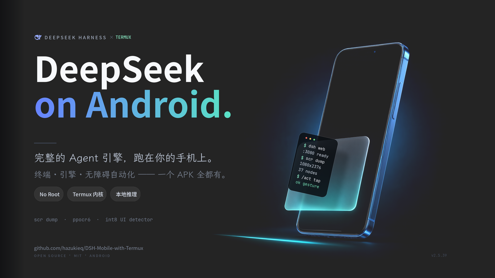

# DSH Mobile

<p align="center">
  
</p>

**把 DeepSeek Harness 完整跑在 Android 上：官方引擎 + 自带 Termux 用户态，免 Root、免电脑。**

[](LICENSE)


---

## 核心能力

**1. 引擎即应用** — 官方 `dsh 0.2.2-rc.1` 与 bionic Node.js 全部打包进 APK，装好就能用；引擎只监听 `127.0.0.1`。

**1.1 移动端界面由引擎自己适配** — 自 `dsh 0.2.2` 起上游 Web UI 原生支持窄屏（侧栏收成抽屉、顶栏紧凑、输入区自适应），因此**不再叠加任何客户端皮肤**：早期那层 `mobile-ui` 客户端插件（靠 CSS Modules 哈希前缀注入样式）已整体移除——它只是重复改造，还会随上游每次改哈希而失效。

**2. 真 Termux 用户态** — 与 Termux 同包名（`com.termux`），`$PREFIX` 就是 `files/usr`，`pkg` / `apt` / `dpkg` / 真 bash 原生可用。内置 VT100/xterm 终端：多会话、真实 PTY、CJK 宽字符、真彩、可调字号。

**3. 手机能力桥** — 只监听 `127.0.0.1:3083`，token 每次启动随机生成并注入引擎。**90+ 路由、40+ `scr` 子命令、14 个 gate 脚本**，动作原语覆盖点击 / 长按 / 双指 / 滑动 / 滚动查找 / 输入 / 按键 / 启动 / 开关；`POST /act` 的 steps 另带五个高阶原语：`motion`（画面是否在动）、`scroll-probe`（滚动方向是否生效）、`drag-fast`（限时拖动 / 进度条）、`skip`（跳过开屏广告）、`transient`（等浮层出现后再点，带硬预算）。`POST /agent/prompt` 可让手机里的 agent 自己去跑这条链。

**3.1 事务内截图（3.0）** — `POST /act` 的 steps 支持 `{"shot":true}`，一条命令「点一下 + 等 450ms + 拍照」；`/act` 顶层支持 `"afterShot":true` 收尾补一张；`scr tap --no-shot <x> <y>` 可跳过回执截图（30–70ms，默认路径 0.5–0.8s）。`/screenshot`、`/ocr` 的回执带 `capturedAt` / `latencyMs`，能判定「这张图是不是操作之后拍的」。典型案例见 [docs/APP-CASES/bilibili.md](docs/APP-CASES/bilibili.md)。

**4. 看得懂界面** — 三层识别：无障碍节点树 → **PP-OCRv6（进程内 ONNX 推理）** → int8 单类 `icon` 检测模型（30 MB，专补「没有文字的控件」，默认关闭、`icon=1` 开启）。附 `scr calib` 坐标自校准：同一批文本的 a11y 与 OCR 坐标做最小二乘，按截图尺寸分桶修正。

**4.1 OCR 双引擎（3.0）** — 热路径默认走系统 **ML Kit**（整屏约 300 ms，UI 小字识别率最高）；`/ocr?engine=ppocr6` 走**APK 自带**的 PP-OCRv6 det/rec，用 `onnxruntime-android` 直接在 Kotlin 里推理，**不需要 Termux 里装 Python**（早期那条 `python + onnxruntime` 路径降级为可选兜底）。二者实测对照见 [docs/qa/ppocr-native-report.md](docs/qa/ppocr-native-report.md)：ML Kit 快 4 倍、擅长 UI 小字；PP-OCR 更擅长中文正文与排版符号，且完全离线、不依赖 GMS。

**5. 能跳出应用再回来** — `POST /open` 把 `weixin://` / `alipays://` / App Link / 指定包或 Activity 直接送到目标 App，回执带真实前后台（`before` / `after` / `changed`）；`POST /wait-app` 等用户付完款、授完权回到会话，不用轮询截图。

**6. 引擎可滚动升级** — APK 内置引擎只是起点：`dsh-update` 支持 `stage` / `apply` / `rollback` 三段式换引擎，失败了自动回退到上一个可用版本。日常只换 JS 闭包（复用 Termux 运行时，20 秒出一个 tar）；换 node 或加原生库时才重收运行时。在手机上自己 `pkg install nodejs` 编译、或在 PC 上用 NDK 十字编原生库都可以，做法见 [docs/ENGINE-BUILD.md](docs/ENGINE-BUILD.md)。

**7. 进度看得见** — 悬浮窗由引擎事件驱动，输出「思考 / 工具 / 结果 / 回复」链路，可拖动贴边、长文在卡片内滚动；也可切到通知模式或干脆关闭（关掉后所有 a11y / OCR / 分享 / 音量 / 安装能力照常工作）。

**8. 音量与安装（3.0）** — `GET/POST /volume`：读写媒体 / 铃声 / 通知 / 闹钟 / 系统音量，回执带 `before` / `after` / `changed` / `appop`，谎报成功是不会的；必要时 `{"openPanel":true}` 拉起系统音量面板让 agent 自己拖滑块。`GET/POST /install`：用 `PackageInstaller` 建会话并拉起系统安装器，**最后一步由用户确认**（Android 14+ 起侧载必须人工确认，有的机型还叠生物识别，所以这里不做自动点按）。

---

## 3.0-alpha 线的新东西

3.0 不是换引擎，而是把「手机上真的能用」这一层补齐。这一轮的高密度修复都带真机取证：

| 主题 | 结论 |
|---|---|
| 悬浮窗不再闪 | 截图避让从「每个请求藏一次窗」下沉到「手势真的压到球才藏」；`/overlay` 进度推送（约 250 ms 一条）彻底退出避让逻辑。vivo 真机闪烁占空比 35% → 0 |
| 截图零闪烁 | 自家窗口用 `takeScreenshotOfWindow` 逐窗口合成（含状态栏、输入法），不再需要把悬浮窗藏起来；`?flash=1` 保留为「要像素级证据」的回退路径 |
| 点得开 / 关得住 | 修掉「档位与渲染态脱钩」（看起来是球、内部以为展开）与「展开卡片锚到屏幕外」；「关闭悬浮窗」加入模式闸门，不再 11 秒后自己冒出来 |
| 退出即闭环 | 用户「退出」后保活心跳不再把球拉回来；重开 App 会自动恢复（把「退出抑制」和「设置关闭」分开） |
| 小窗 / 旋转不重载 | `configChanges` 补齐 `screenLayout｜smallestScreenSize｜density` 等，去掉 `onConfigurationChanged` 里的 `webView.reload()`；`wm size` / `wm density` / 自由窗口改尺寸时 WebView 状态不丢 |
| 原生页朝向一致 | 设置 / 关于 / 授权页不再写死竖屏，跟随「横屏模式」偏好（平板横屏下不再突然转竖） |
| WebView 收口 | 默认隐藏原生滚动条、禁用双指缩放、`textZoom=100`、混合内容兼容模式、安全项显式写死；详见 [docs/qa/webview-config-report.md](docs/qa/webview-config-report.md) |
| 顶部工具栏 | 默认收起，顶部小把手唤回，选择持久化——不再每次都要点「隐藏」 |
| 免 root 调试通道 | `content://com.termux.adb/{token,state,exec}`（需 DUMP 权限 + 全局开关），可在 App 的 Termux 环境里执行命令，不依赖手机输入法；用法见 [docs/ADB-DEBUG-CHANNEL.md](docs/ADB-DEBUG-CHANNEL.md) |

## 本地运行的模型

APK 里没有大语言模型——**推理走你配置的 API**。默认的两类识别模型（OCR `tiny` + icon 检测）**全部随包附带、离线可用**，装完不联网就能用；只有可选的 OCR `medium` 档需要另外下载。

| 模型 | 任务 | 体积 | 运行时 | 默认 |
|---|---|---|---|---|
| **PP-OCRv6** `det_tiny` + `rec_tiny`（ONNX）[¹] | 截图文字识别 + 行框坐标 | 1.8 MB + 4.5 MB | **进程内 ONNX Runtime 1.31（`onnxruntime-android`，CPU）** | 开（`engine=ppocr6`） |
| **int8 单类 icon 检测**（ONNX）[²] | 无文字控件（图标、头像、开关、tab） | 30 MB | ONNX Runtime 1.31（CPU，640×640，单类 + NMS） | **关**（`icon=1` 开启） |
| 系统 ML Kit Text Recognition | 热路径整屏 OCR（点击链路预热） | 0（系统组件） | GMS / 厂商实现 | 开（无 GMS 时自动回退 PP-OCR） |

### 1. 界面理解模型（APK 内，离线）

- 模型随包放在 `assets/models/omni_icon.onnx` 与 `assets/ppocr6/`，首次使用时复制到 `cacheDir`；换模型只需改 assets（缓存文件名为 `omni_icon_640.onnx`，改形状必须换名，否则会继续用旧缓存）。默认档（`tiny`）随 APK 附带、零联网；只有可选的高精度档 `medium` 才按需从 ModelScope 下载（`/ocr?tier=medium`）。
- **PP-OCR 的 det/rec 全部在 App 进程内推理**（`app/src/main/java/app/dsh/mobile/PpOcrNative.kt`，约 490 行）：DB 检测（阈值 0.2 / box 0.45 / unclip 1.4）、4 连通域、CTC 解码、字典从 `rec_tiny.yml` 解析——与官方 `ppocr6` 脚本逐参数对齐，同图对照框位中位偏移 **0.0 px**。整屏 1080×2376 约 1.0–1.8 s（全分辨率检测），`detmax=1600` 可换到 ~0.9 s、代价是框位略偏。
- 推理全部在 CPU：icon 检测约 **0.7 s/帧**；ML Kit 整屏约 **300 ms**；两者都不跑时 `/scene` 只用无障碍节点树，几乎无延迟。
- 三层结果合并进 `/scene`：无障碍节点树 → OCR 文本框 → icon 框，重叠的按「中心点落在谁里面」去重。文字控件永远由 a11y/OCR 负责，icon 只补空缺，因此不开它也完全可用。
- 坐标可信度用 `scr calib` 自校准：同一批文本的 a11y 框中心与 OCR 框中心做最小二乘，按截图尺寸分桶存 `coord-calib.json`，修正厂商 webview/eink 类偏移。
¹ [PaddleOCR](https://github.com/PaddlePaddle/PaddleOCR)（PP-OCRv6，Apache-2.0）；² [microsoft/OmniParser](https://github.com/microsoft/OmniParser) 的 `icon_detect`（按其仓库许可，本项目蒸馏 + 量化到 30 MB）；推理框架 [onnxruntime](https://github.com/microsoft/onnxruntime)（MIT）。完整清单见 [docs/CREDITS.md](docs/CREDITS.md)。

### 2. Termux 用户态（模型和工具都跑在它上面）

上层所有本地能力——`pkg` 装出来的 Python/Node、`rg`/`git`、脚本 gate——都由**随包内置的真 Termux 前缀**承载，不需要另装 Termux：

```bash
echo $PREFIX          # /data/user/0/com.termux/files/usr
pkg install python    # 真 dpkg/apt 流程，装完即用
python3 -c "import onnxruntime as o; print(o.get_available_providers())"
```

OCR 已不需要 Python（`onnxruntime-android` 在进程内跑）；只有想用旧版 `ppocr6` 脚本或自己写 Python 工具时才需要 `pkg install`。

从设备上取模型文件：`assets/models/`、`assets/ppocr6/` 属于构建产物，运行时副本在 App 私有目录，取用请走 `scr`/`/scene` API —— 参考 [Termux](https://github.com/termux/termux-app) 的目录约定。

### 3. 海报来源

仓库里的 banner 不是素材站下的图，是本地用 [Qwen-Image 2.1](https://github.com/QwenLM/Qwen-Image) 生成底图、再用 Pillow 排版的，脚本与参数都在版本库里：

```bash
# 1) 起 ComfyUI（默认 127.0.0.1:8188），加载 Qwen-Image 2.1 int8 convrot + Qwen3-VL 8B 文本编码器
python main.py --listen 127.0.0.1 --port 8188
# 2) 生成底图：<prompt> <输出前缀> [seed]，1600x896 / 28 steps / cfg 3.0
python3 docs/promo/qwen_t2i.py "Apple keynote style hero product shot of a black smartphone floating in a dark void, cyan rim light, screen completely black, no UI, no letters" hero_v6 4242
# 3) 排版：2x 画布，导出 1600x900 / @2x / webp / social
python3 docs/promo/render_banner_v2.py docs/promo/source/qwen-hero-v6.png docs/promo/dsh-mobile-github
```

提示词、seed 与产物 sha256 都记在 [`docs/promo/manifest.json`](docs/promo/manifest.json)。这一步与 App 运行无关，纯桌面出图用。

## 无障碍的边界

无障碍只做三件事：读别的 App 的界面与像素、往别的 App 注入手势文字按键、消费无障碍事件（如 `/notif` 读通知、`/interference` 判断干扰）。

启动、跳转、分享、媒体播放、发通知、TTS、文件、**音量读写、APK 安装（由用户在系统安装器确认）**、引擎、PTY、插件，以及 App 自身窗口截图（`/app-screenshot`，PixelCopy）与**免闪截图**（`/screenshot` 的窗口合成路径）**都不需要**无障碍，关着也照常工作。完整清单见 [docs/A11Y-SCOPE.md](docs/A11Y-SCOPE.md)。

## 安装

1. 从 [Releases](../../releases) 下载 `arm64-v8a` APK（约 289 MiB，含引擎、Node、OCR 与图标检测模型）。
2. 打开 App，首次启动会解压内置运行时，随后直接进入内嵌 WebUI。
3. 在 WebUI 里配置模型服务地址与 API Key。

可选授权：通知（Android 13+）用于通知模式；「悬浮窗」权限用于默认的悬浮窗进度卡片；无障碍按需开启。

> **装之前建议先看 [docs/SECURITY-AUDIT.md](docs/SECURITY-AUDIT.md)**：权限逐条用途、对外组件清单、默认网络面，以及一条能自己跑的取证命令 `scripts/audit-apk.sh <apk>`（签名指纹 / 权限 / 导出组件 / 载荷哈希 / 全部 URL）。

## 安全与审计

装之前不想只凭「开源所以安全」？这套东西是**可自证**的：

- 一条命令取证：`scripts/audit-apk.sh app-release.apk` —— 签名指纹、权限清单、导出
  组件、内置载荷哈希、APK 内所有 URL，一次全打出来。
- 逐项对照：[docs/SECURITY-AUDIT.md](docs/SECURITY-AUDIT.md) 有权限用途表（每条权限
  给不给的代价）、导出组件清单、网络面（默认只有 `127.0.0.1` 与模型 API）、数据落盘
  位置与清除方式、供应链来源与 `engine-manifest.json` 校验方法。
- 想交给 AI 或外部审计员：该文档第 8 节有一段可直接粘贴的审计 prompt（要求逐条跑命令、
  不接受「复述文档」当结论）。
- 调试通道默认三重闸门：`content://com.termux.adb/*` 需要 shell 才有的 `DUMP` 权限 +
  代码内二次校验，且可用 `settings put global dsh_adb_bridge 0` 一键关掉。

关键事实：**没有我们的服务器，没有遥测/统计/广告**；引擎、会话、凭证都在 App 私有目录；
桥与 WebUI 只绑回环，桥请求必须带每次启动随机生成的 token；局域网 WebUI 默认关闭。

## 构建

前置：JDK 17、Android SDK（`compileSdk = 36`）、系统 Gradle（仓库不带 wrapper）。

```bash
export ANDROID_HOME=$HOME/Android/Sdk
gradle -p . assembleRelease -Pabi=arm64-v8a
# 产物：app/build/outputs/apk/release/app-release.apk
```

本仓库**不含任何 GitHub Actions 工作流**（2.9.112 起移除）：构建、门禁与发布都在本地手动执行。

```bash
bash scripts/acceptance.sh --static   # i18n / 文档边界 / 悬浮窗避让形状闸门 / pnpm 完整性
```

## 文档

| 文档 | 内容 |
|---|---|
| [docs/CLICK_CHAIN_UPGRADE.md](docs/CLICK_CHAIN_UPGRADE.md) | 点击链路：a11y / PP-OCRv6 / icon 如何合并进 `/scene` |
| [docs/A11Y-SCOPE.md](docs/A11Y-SCOPE.md) | 哪些能力需要无障碍、关着时如何降级 |
| [docs/PAYMENT-LINKS.md](docs/PAYMENT-LINKS.md) | 微信/支付宝跳转与回流 |
| [docs/TERMINAL_AND_LINUX.md](docs/TERMINAL_AND_LINUX.md) | 内置终端（PTY / VT100 / 与 AI 同环境） |
| [docs/ENGINE-BUILD.md](docs/ENGINE-BUILD.md) | 引擎层构建：闭包滚动升级、NDK 十字编、Termux 运行时收集 |
| [docs/OVERLAY.md](docs/OVERLAY.md) | 悬浮窗全链路：可见性铁律、截图避让、窗口类型、点不开/关不住的根因 |
| [docs/PROGRESS_OVERLAY.md](docs/PROGRESS_OVERLAY.md) | 悬浮窗链路、贴边与文本上限 |
| [docs/LAN_WEBUI.md](docs/LAN_WEBUI.md) | 局域网访问手机里的原生 WebUI |
| [docs/ENGINE_RESTART.md](docs/ENGINE_RESTART.md) | 受控重启路径与端口竞态 |
| [docs/ADB-DEBUG-CHANNEL.md](docs/ADB-DEBUG-CHANNEL.md) | 免 root 的 adb 调试通道：取 token / 读状态 / 在 App 环境里跑命令 |
| [docs/APP-CASES/bilibili.md](docs/APP-CASES/bilibili.md) | 案例：自绘控件的播放页怎么读、怎么点、怎么留证 |
| [docs/android-agent-routes.md](docs/android-agent-routes.md) | 能力桥路由（agent 视角） |
| [docs/SECURITY-AUDIT.md](docs/SECURITY-AUDIT.md) | 安全与审计：权限表、对外组件、网络面、自带审计脚本与审计 prompt |
| [docs/qa/](docs/qa/) | 逐次真机修复报告：悬浮窗闪烁/点不开、免闪截图、PP-OCR 原生化、音量、安装、配置变更不重载 |

## 风险与反馈

- 内置 **Root / Shizuku** 三档权限；开启特权模式等于把设备控制权交给模型，风险自负。
- 问题与建议请开 [Issue](../../issues)。

## 参考与引用

本项目的核心能力来自这些开源项目，完整清单与分发注意事项见 [docs/CREDITS.md](docs/CREDITS.md)：

| 项目 | 在本项目里承担什么 | 许可 |
|---|---|---|
| [DeepSeek Harness (dsh)](https://github.com/deepseek-ai/deepseek-harness) | Agent 引擎：会话、工具调用、插件系统、WebUI | 见上游 |
| [Termux](https://github.com/termux/termux-app) | 运行时用户态：`$PREFIX`、`pkg`/`dpkg`、bash、终端约定 | GPL-3.0 |
| [PaddleOCR / PP-OCRv6](https://github.com/PaddlePaddle/PaddleOCR) | 截图文字识别（APK 内置 `det_tiny` + `rec_tiny`，进程内 ONNX 推理） | Apache-2.0 |
| [microsoft/OmniParser](https://github.com/microsoft/OmniParser) | 无文字控件检测模型来源（蒸馏 + int8 量化后 30 MB） | 见上游 |
| [ONNX Runtime](https://github.com/microsoft/onnxruntime) | 设备端推理（CPU，`onnxruntime-android`） | MIT |
| [Qwen-Image 2.1](https://github.com/QwenLM/Qwen-Image) + [ComfyUI](https://github.com/comfyanonymous/ComfyUI) | 仅用于生成本仓库海报底图，不参与 App 运行 | Apache-2.0 / GPL-3.0 |
| [霞鹜文楷](https://github.com/lxgw/LxgwWenKai) · [JetBrains Mono](https://github.com/JetBrains/JetBrainsMono) | 海报排版字体 | OFL-1.1 |

重新分发 APK 时请注意 Termux 的 GPL-3.0 义务（详见 [docs/CREDITS.md](docs/CREDITS.md#分发注意)）。

## 分叉与许可

本项目是 **[Soodok/Deepseek-Harness-Local-Android](https://github.com/Soodok/Deepseek-Harness-Local-Android)** 的分叉，遵循 **MIT** 许可，保留上游完整历史，可持续合并上游改动。

- 原始版权：`Copyright (c) 2026 Soodok`
- 引擎与插件生态归 [deepseek-ai/deepseek-harness](https://github.com/deepseek-ai/deepseek-harness)

## English

**DSH Mobile** runs the official DeepSeek Harness engine plus a bundled Termux userland on Android — no root, no PC, APK only. It adds a local bridge (`127.0.0.1:3083`) for phone control (accessibility + PP-OCRv6 running in-process through `onnxruntime-android` + optional int8 icon detection), transactional screenshots (`/act` with `{"shot":true}`, `capturedAt`/`latencyMs`), cross-app payment hand-off (`/open`, `/wait-app`), volume read/write (`/volume`), APK sideload that hands the final confirmation to the system installer (`/install`), a root-free adb debug channel (`content://com.termux.adb/*`), a native terminal, an engine-event-driven progress overlay, and zero-flash screenshots via per-window `takeScreenshotOfWindow` compositing. Version 3.0-alpha-1 (686). No CI workflows live in this repo — build with Gradle and publish by hand. Fork of [Soodok/Deepseek-Harness-Local-Android](https://github.com/Soodok/Deepseek-Harness-Local-Android), MIT.
