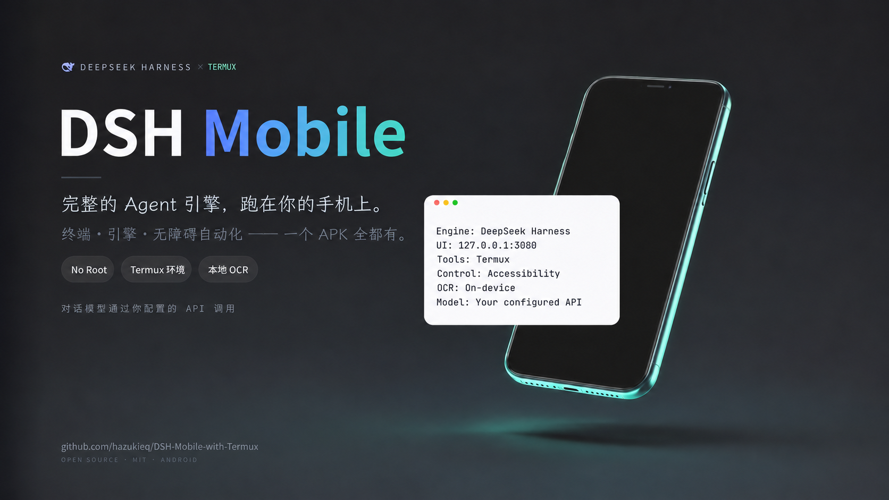

# DSH Mobile with Termux

**在 Android 上运行 DeepSeek Harness，让 Agent 使用手机界面、文件和命令行工具。**

[下载 APK](https://github.com/hazukieq/DSH-Mobile-with-Termux/releases) · [使用文档](docs/README.md) · [反馈问题](https://github.com/hazukieq/DSH-Mobile-with-Termux/issues) · [English](README_EN.md) · [Deutsch](README.de.md)

<p align="center">
  
</p>

DSH Mobile 将适配 Android 的 DeepSeek Harness 引擎、WebUI、Node.js 和 Termux 用户态打包进 APK。
安装后可直接在手机上使用会话、工具和插件，无需另装 Termux，也不需要 Root 或电脑。

引擎在手机上运行；对话模型通过你配置的模型服务地址和 API Key 调用。APK 不附带用于对话的大语言模型。
本地 OCR 与可选图标检测用于识别手机界面。

## 可以做什么

| 能力 | 使用方式 |
|---|---|
| 对话与工具 | 在内嵌 WebUI 中管理会话、使用工具和插件；手机窄屏布局由引擎 WebUI 提供 |
| 手机操作 | 授权无障碍后读取界面、点击、滑动、输入和截图，通过本地能力桥供 Agent 使用 |
| 界面识别 | 默认使用随包 ML Kit；可选进程内 PP-OCRv6 和图标检测，OCR 无需安装 Python |
| 终端与文件 | 内置 PTY 终端，与引擎共享 Termux 环境；使用 `pkg` / `apt` 安装工具，处理和分享文件 |
| 后台进度 | 显示悬浮球/卡片或通知，也可关闭；卡片支持正文滚动、拖动贴边和会话/耗时显示 |
| Android 交接 | 打开应用与链接、调用分享面板、播放媒体、控制音量；APK 安装交由系统安装器确认 |
| 局域网访问 | 按需开启带访问码的 LAN WebUI，在其他设备上访问手机里的引擎 |

## 安装与开始

1. 从 [Releases](https://github.com/hazukieq/DSH-Mobile-with-Termux/releases) 下载适合设备的 APK，常用构建为 `arm64-v8a`。
2. 安装并打开应用，完成语言、显示方向和权限模式引导。首次使用选择 **Normal（普通模式）** 即可。
3. 等待内置运行时解压、引擎启动，在 WebUI 中配置模型服务地址和 API Key。
4. 按实际任务授予通知、文件访问或无障碍权限，再开始使用。

源码最低支持 Android 8.0（API 26）；具体运行时和界面能力还取决于设备系统与 WebView。
跨应用截图需要 Android 11（API 30）或更高版本及已连接的无障碍服务。旧 WebView 会收到应用内更新提示。

**与原版 Termux 的关系：** 本应用包名为 `com.termux`，不能与原版 Termux 或其他同包名应用共存。
更换应用前请先备份已有 Termux 数据；签名不同的 APK 无法直接覆盖安装。内置终端的用法见
[终端与 Linux 环境](docs/TERMINAL_AND_LINUX.md)。

## 权限如何选择

普通模式可以运行引擎、终端和文件工具，也可以在授权无障碍后操作手机。Root 不是手机操作或浮窗的前提。

| 选项 | 作用与边界 |
|---|---|
| Normal | 引擎以应用 UID 运行，内置维护与回退路径不自动调用 su 或 Shizuku |
| Shizuku | 按授权提供 shell 能力，引擎本体仍使用应用 UID；通道失败不会转用 Root |
| Root | 显式选择后以 Root 权限运行引擎，扩大 Agent 可访问和修改的范围 |
| 无障碍 | 读取其他应用的界面、注入操作、获取屏幕截图及相关事件；引擎、终端、分享和普通文件操作不依赖它 |
| 悬浮窗 | 无障碍已连接时可直接显示；否则需要系统的「显示在其他应用上层」权限 |
| 通知与文件访问 | 分别用于通知提示与授权范围内的文件读写，按应用提示和任务需要开启 |

悬浮球点击展开，卡片左侧圆点点击收起，拖动可调整位置。设置中的显示方式支持悬浮窗、通知和关闭。
关闭进度显示不影响无障碍、OCR 或终端；通知栏的「退出」会停止引擎并移除浮窗，重新打开应用后恢复。

完整依赖范围见 [无障碍能力边界](docs/A11Y-SCOPE.md)，浮窗使用见 [后台进度](docs/PROGRESS_OVERLAY.md)。

## 数据与网络

引擎 WebUI 默认监听本机 `127.0.0.1:3080`，能力桥监听 `127.0.0.1:3083` 并校验请求 token。
局域网访问默认关闭，开启后通过独立代理提供访问码验证。

配置和凭据保存在应用私有目录；会话与工作区可外置到共享存储。模型请求以及搜索、网页抓取、TTS、
下载和插件执行可能联网，因此数据是否发送到外部取决于你配置的服务与运行的任务。
备份时需同时核对私有数据与外置文件的实际位置，不能仅凭逻辑路径判断卸载后是否保留。

权限用途、网络入口、调试通道和 APK 检查方法见 [权限与审计说明](docs/SECURITY-AUDIT.md)。

## 从源码构建

准备 JDK 17、Gradle 8.9、Android SDK 36、CMake 3.22.1 和对应 NDK。仓库不带 Gradle wrapper。

**构建前需准备运行时资产。** Termux bootstrap 与适配引擎层等大文件不随 Git 入库；仅克隆源码不足以生成可用 APK。
请先按 [构建环境](docs/DEVELOPMENT-ENV.md) 和 [引擎构建](docs/ENGINE-BUILD.md) 准备资产，
并核对 pnpm 与原生依赖闭包。随后在仓库根目录执行：

```sh
export ANDROID_HOME="$HOME/Android/Sdk"
bash scripts/acceptance.sh --static
gradle testDebugUnitTest
gradle assembleRelease -Pabi=arm64-v8a
```

产物：`app/build/outputs/apk/release/app-release.apk`。使用项目 Gradle 流程构建，不以 `android build` 替代。
发布签名通过 `keystore.properties` 或环境变量配置；未配置时 release 使用 debug 签名，不能因此认定它是正式发布签名。
详见 [签名与构建验证](docs/DEVELOPMENT-ENV.md)。

设备装机、截图和交互优先使用 android CLI，约定见 [Android CLI 手册](docs/ANDROID-CLI.md)。
当前普通模式浮窗回归的设备、构建、结果及未覆盖项见 [真机回归报告](docs/qa/overlay-physical-normal-report.md)。

## 文档入口

| 文档 | 内容 |
|---|---|
| [文档索引](docs/README.md) | 用户说明、开发资料与设备证据的分类入口 |
| [手机操作指南](docs/ACCESSIBILITY.md) | 无障碍、读屏、点击与操作回执 |
| [界面识别与点击链路](docs/CLICK_CHAIN_UPGRADE.md) | 节点、OCR、图标检测与事务操作 |
| [终端与 Linux 环境](docs/TERMINAL_AND_LINUX.md) | PTY、包管理和内置运行时 |
| [悬浮窗说明](docs/OVERLAY.md) | 形态、权限、生命周期与截图/手势避让 |
| [局域网 WebUI](docs/LAN_WEBUI.md) | 开启 LAN 代理、访问码与连接方式 |
| [引擎构建](docs/ENGINE-BUILD.md) | 引擎闭包、原生依赖与运行时制作 |
| [权限与审计](docs/SECURITY-AUDIT.md) | 网络、数据、组件及验证入口 |

## 上游与许可

本项目分叉自 [Soodok/Deepseek-Harness-Local-Android](https://github.com/Soodok/Deepseek-Harness-Local-Android)，
基于 [DeepSeek Harness](https://github.com/deepseek-ai/deepseek-harness) 与
[Termux](https://github.com/termux/termux-app)，并使用 ML Kit、PaddleOCR、ONNX Runtime 等组件。

本仓库代码采用 [MIT 许可](LICENSE)，保留原始版权声明。APK 中的运行时、依赖和模型分别遵循各自许可证；
来源、用途与分发说明见 [参考与引用](docs/CREDITS.md)。
