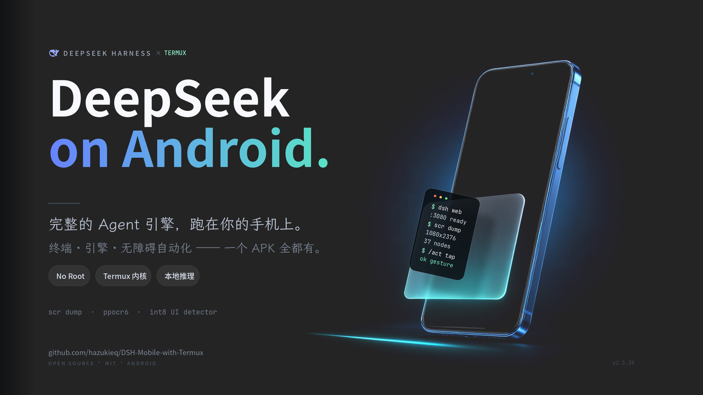

# DSH Mobile

<p align="center">
  
</p>

**把 DeepSeek Harness 完整跑在 Android 上：官方引擎 + 自带 Termux 用户态，免 Root、免电脑。**

[](LICENSE)


---

## 核心能力

**1. 引擎即应用** — 官方 `dsh 0.2.1-rc.2` 与 bionic Node.js 全部打包进 APK，装好就能用；引擎只监听 `127.0.0.1`。

**2. 真 Termux 用户态** — 与 Termux 同包名（`com.termux`），`$PREFIX` 就是 `files/usr`，`pkg` / `apt` / `dpkg` / 真 bash 原生可用。内置 VT100/xterm 终端：多会话、真实 PTY、CJK 宽字符、真彩、可调字号。

**3. 手机能力桥** — 只监听 `127.0.0.1:3083`，token 每次启动随机生成并注入引擎。86 个路由、36 个 `scr` 子命令、16 个 gate 脚本，动作原语覆盖点击 / 长按 / 双指 / 滑动 / 滚动查找 / 输入 / 按键 / 启动 / 开关。

**4. 看得懂界面** — 三层识别：无障碍节点树 → PP-OCRv6 → int8 单类 `icon` 检测模型（30 MB，专补「没有文字的控件」，默认关闭、`icon=1` 开启）。附 `scr calib` 坐标自校准：同一批文本的 a11y 与 OCR 坐标做最小二乘，按截图尺寸分桶修正。

**5. 能跳出应用再回来** — `POST /open` 把 `weixin://` / `alipays://` / App Link / 指定包或 Activity 直接送到目标 App，回执带真实前后台（`before` / `after` / `changed`）；`POST /wait-app` 等用户付完款、授完权回到会话，不用轮询截图。

**6. 进度看得见** — 悬浮窗由引擎事件驱动，输出「思考 / 工具 / 结果 / 回复」链路，可拖动贴边、长文在卡片内滚动；也可切到通知模式。

## 无障碍的边界

无障碍只做三件事：读别的 App 的界面与像素、往别的 App 注入手势文字按键、消费无障碍事件（如 `/notif` 读通知、`/interference` 判断干扰）。

启动、跳转、分享、媒体播放、发通知、TTS、文件、引擎、PTY、插件，以及 App 自身窗口截图（`/app-screenshot`，PixelCopy）**都不需要**无障碍，关着也照常工作。完整清单见 [docs/A11Y-SCOPE.md](docs/A11Y-SCOPE.md)。

## 安装

1. 从 [Releases](../../releases) 下载 `arm64-v8a` APK（约 281 MiB，含引擎、Node、OCR 与图标检测模型）。
2. 打开 App，首次启动会解压内置运行时，随后直接进入内嵌 WebUI。
3. 在 WebUI 里配置模型服务地址与 API Key。

可选授权：通知（Android 13+）用于通知模式；「悬浮窗」权限用于默认的悬浮窗进度卡片；无障碍按需开启。

## 构建

前置：JDK 17、Android SDK（`compileSdk = 36`）、系统 Gradle（仓库不带 wrapper）。

```bash
export ANDROID_HOME=$HOME/Android/Sdk
gradle -p . assembleRelease -Pabi=arm64-v8a
# 产物：app/build/outputs/apk/release/app-release.apk
```

## 文档

| 文档 | 内容 |
|---|---|
| [docs/CLICK_CHAIN_UPGRADE.md](docs/CLICK_CHAIN_UPGRADE.md) | 点击链路：a11y / PP-OCRv6 / icon 如何合并进 `/scene` |
| [docs/A11Y-SCOPE.md](docs/A11Y-SCOPE.md) | 哪些能力需要无障碍、关着时如何降级 |
| [docs/PAYMENT-LINKS.md](docs/PAYMENT-LINKS.md) | 微信/支付宝跳转与回流 |
| [docs/TERMINAL_AND_LINUX.md](docs/TERMINAL_AND_LINUX.md) | 内置终端（PTY / VT100 / 与 AI 同环境） |
| [docs/PROGRESS_OVERLAY.md](docs/PROGRESS_OVERLAY.md) | 悬浮窗链路、贴边与文本上限 |
| [docs/LAN_WEBUI.md](docs/LAN_WEBUI.md) | 局域网访问手机里的原生 WebUI |
| [docs/ENGINE_RESTART.md](docs/ENGINE_RESTART.md) | 受控重启路径与端口竞态 |
| [docs/android-agent-routes.md](docs/android-agent-routes.md) | 能力桥路由（agent 视角） |

## 风险与反馈

- 内置 **Root / Shizuku** 三档权限；开启特权模式等于把设备控制权交给模型，风险自负。
- 问题与建议请开 [Issue](../../issues)。

## 分叉与许可

本项目是 **[Soodok/Deepseek-Harness-Local-Android](https://github.com/Soodok/Deepseek-Harness-Local-Android)** 的分叉，遵循 **MIT** 许可，保留上游完整历史，可持续合并上游改动。

- 原始版权：`Copyright (c) 2026 Soodok`
- 引擎与插件生态归 [deepseek-ai/deepseek-harness](https://github.com/deepseek-ai/deepseek-harness)

## English

**DSH Mobile** runs the official DeepSeek Harness engine plus a bundled Termux userland on Android — no root, no PC, APK only. It adds a local bridge (`127.0.0.1:3083`) for phone control (accessibility + PP-OCRv6 + optional int8 icon detection), cross-app payment hand-off (`/open`, `/wait-app`), a native terminal, and an engine-event-driven progress overlay. Fork of [Soodok/Deepseek-Harness-Local-Android](https://github.com/Soodok/Deepseek-Harness-Local-Android), MIT.
