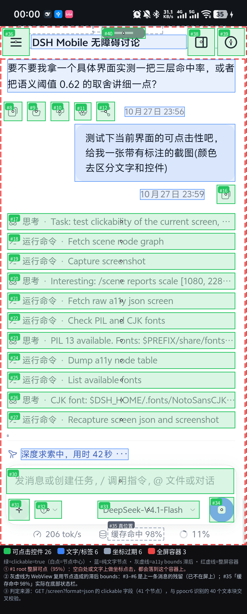
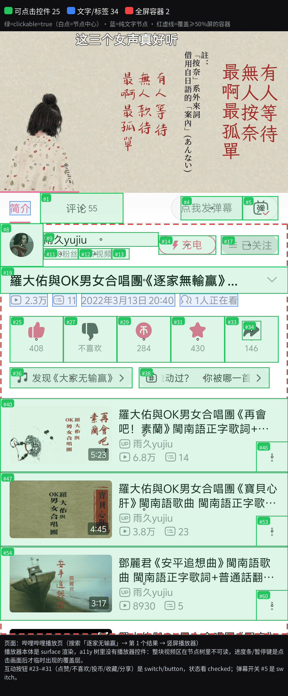

# 点击链路

点击链路是「读屏 → 定位 → 点击 → 校验」四段。读屏由三层证据合成：**无障碍节点树（真相源）**、
**PP-OCRv6 文本识别（补文字与坐标）**、**单类 `icon` 控件检测（补无文字控件）**；点击后用回执、内联
`expect` 或读屏文本差校验。本文记录当前实现、字段、阈值与失效边界。

## 节点与读屏接口

- `GET /screen?format=json`：节点带 `bounds:[x0,y0,x1,y1]`、`center:[x,y]`、`x/y/w/h`、
  `clickable/checkable/checked/scrollable/editable`；`POST /tap-id {"id":"..."}` 回执带 `bounds` 与
  `boundsCenter`，用来核对空心图标/行中心。
- `scr dump` 首行固定 `fg=<package> WxH Nnodes`（`DshAccessibilityService.kt:1002`）：跨 App 操作先自证前台包；
  `/scene` 不带包名，跨窗口场景先用 `scr dump` 确认，再按坐标操作。

## tap 与内联 expect 校验

```json
POST /tap
{"text":"搜索","expect":{"anyText":["综合","番剧"],"timeoutMs":4000}}
```

回执带 `ok/dispatched/verified/verifyHow:"anyText:综合"/elapsedMs/foreground/foregroundChanged/shot`；
`verified:false` 时带 `failedAt:"tap"`、`screenHash`、`nearest` 候选与 `hint`。带 `expect` 的 tap 不会被
`instant` 后处理覆盖 `verify/hint`；`expect` 超时回执另带 `elapsedMs`、`foregroundChanged`、`screenHash`。

## 无障碍不可用时的回执

依赖无障碍的端点返回 503：

```json
{"ok":false,"error":"a11y_off","code":"a11y_off","reason":"...","retryable":false,"action":"open_a11y_settings","actionHint":"POST /a11y/enable opens the system accessibility page"}
```

- 短暂未绑定：`error:"a11y_connecting"`、`retryable:true`，等约 2s 重试一次；`POST /a11y/enable`
  一次调用打开系统无障碍设置页；
- 曾授权后被 force-stop/更新停用（`accessibility_listed_but_disabled:true`）提示去重开，而不是当成
  「从未授权」。

## /scene：单一合并视图

`GET /scene` 参数：`ocr=0` 关 OCR、`engine=mlkit|ppocr6` 指定引擎、`icon=1` 追加图标层、`region=0`
关增量、`cache=0` 强制重算、`verbose=1` 带 `cls/rid/x/y/w/h`。

```json
{"ok":true,"count":35,"ocrEngine":"mlkit","timings":{"a11y":27,"ocr":348},"scale":[1080,2400],
 "nodes":[{"text":"引擎已就绪…","bounds":[0,105,653,215],"center":[326,160],"source":"a11y","clickable":false},
          {"text":"同意及確認","source":"ocr","clickable":true,"hint":"near-clickable","a11yIndex":12}]}
```

- 分页：`limit` 默认 80、`offset` 0，服务端按 18KB 自动缩页；回 `total/offset/limit/nextOffset`；
- OCR 行合并：同一 y 带 ±18px、间距 < 0.8 字高；OCR 框落在可点 a11y 节点 bounds 内 → 继承
  `clickable`/`a11yIndex`，`hint:"near-clickable"`；`timings` 分开报无障碍与 OCR 耗时，`ocrEngine` 说明
  实际引擎；默认 PP-OCRv6 + `region=1` 增量：同屏无变化 `ocrCached:true, ocrChanged:false`，局部变化回
  `ocrRegion:[l,t,r,b]`，只识别变化区并与上一轮结果合并。

## PP-OCRv6 本地文本识别

- 随 APK 内置 `assets/ppocr6/`：脚本 + `det_tiny.onnx` + `rec_tiny.onnx/yml`（约 6.3MB），引擎启动部署到
  `$PREFIX/bin/ppocr6` 与 `$PREFIX/share/ppocr6/`；`GET /ocr?engine=ppocr6` 依赖缺失回
  `unavailable:true, reason`；
- `&ensure=1` 执行 `pkg install -y python python-numpy python-pillow python-scipy python-onnxruntime`
  并 **reinstall onnxruntime**（Termux 的 python 绑定不随 python 升级自动重装），网络/体积较大，显式触发；
- **python 绑定兜底**：`libortshim.so`（`tools/ortshim/ortshim.c` + `assets/ppocr6/py/onnxruntime.py` 的
  ctypes 实现）让 `import onnxruntime` 在没有 python 绑定时也能工作，shim 部署到 `$PREFIX/share/ppocr6/py/`；
- **medium 档按需下载**：`GET /ocr?engine=ppocr6&download=medium`，源顺序 ModelScope → hf-mirror →
  HuggingFace，支持 `.part` 断点续传（det 62MB + rec 76MB + yml 150KB）；`&models=1` 查状态、
  `&tier=medium` 切档（更慢）；
- **无 a11y 截图回退**：`Privilege.runPrivileged`（Shizuku 优先 → su 兜底）执行系统 `screencap`，回
  `via:"privileged-screencap"`；无 root/Shizuku 仍回 `a11y_off` 并引导开服务；`/scene` 在 ML Kit 不可用
  或 `engine=ppocr6` 时自动用 PP-OCRv6。

## listId / itemIndex

- `/screen?format=json` 与 `/scene`：滚动容器内的可点行带 `listId`、`itemIndex` 与 `label`（行容器本身常
  无 text/desc，label 从子节点聚合最多 3 段）；可滚动容器即使没有文本/desc 也保留一条节点记录，作为锚点；
- `POST /tap {"listId":"L12","itemIndex":3}`：App 实时重读节点树定位并点击，不依赖上一屏坐标；找不到时
  返回 404 + `failedAt:"tap"` + 重新读取的提示。

```
L0 0 | -
L0 1 | 网络 Hazukie-spot
L0 2 | SIM 卡 China Unicom, CMHK
POST /tap {"listId":"L2","itemIndex":0}
→ {"ok":true,"via":"list","listId":"L2","itemIndex":0,"x":540,"y":470,"bounds":[0,364,1080,576]}
```

## /act 事务化

```json
POST /act
{"steps":[
  {"tapDesc":"返回","expect":{"anyText":["引擎已就绪"],"timeoutMs":4000}},
  {"tapDesc":"设置","expect":{"anyText":["权限中心"],"timeoutMs":5000}},
  {"key":"back"}],
 "onFail":"stop"}
```

- 回执每步 `index/action/ok/verified/verifyHow/elapsedMs`，失败带 `failedAt/hint`；顶层
  `ok/elapsedMs/onFail`，可选 `returnScreens:true`（before/after 紧凑读屏）。step 支持 `tap`、`tapDesc`、
  `tapId`、`tapXY`、`listId+itemIndex`、`input(+append)`、`key`、`sleepMs`、`expect`；`swipe` 接受
  `{"x1","y1","x2","y2","durationMs","human":false}` 或 `[x1,y1,x2,y2,durationMs]`；`doubleTap:[x,y]` 配
  顶层 `gapMs`（默认 90，范围 40–400）。`/gesture` 的 swipe 在「距离 >300px 且 duration <300ms」时回
  `warning`，提示会被当成 fling。

## OCR 常驻 worker

`ppocr6_worker.py` 常驻进程只加载一次模型，App 按 JSON 行喂图片路径；进程崩溃/超时自动销毁并回落一次性
CLI。同一屏热调用约 1.2s，区域增量命中约 93ms，截图缓存命中 0ms。

- **`ifChanged=1`**：截图哈希未变时直接回缓存（`changed:false, cached:true, costMs:0`）；**`region=1`**：
  用上一帧降采样做像素 diff，只裁变化区域识别，再与上一轮结果合并。
- **rec 批量推理**：同一批框 pad 到同宽后一次推理（模型拒绝 batch 时自动回落单条）。
- **截图级缓存**：同一张截图 5s 内复用结果（`cached:true, costMs:0`），`cache=0` 强制重算。

## 两层识别：PP-OCRv6 + UI 控件检测

可点目标不是猜出来的，而是三类证据拼出来的：**无障碍节点（真相源）+ OCR 文本（补字）+ 控件检测
（补无字图标）**。本节讲后两层为什么存在、怎么合并、字段长什么样、什么时候失效。

### 为什么需要两层补丁

无障碍节点树只覆盖「原生控件」这一种界面：

- 原生界面：`TextView` / `Button` / `RecyclerView` 行都在树里，带 `bounds`/`center`/`clickable`，直接可点；
- **WebView / Canvas / 自绘界面没有可点节点**：图 1 的 WebView 聊天页整屏 41 个节点里，可点的多是
  「整条消息行」，真正的按钮是 CSS 画的、连节点都不存在；**纯文字按钮 `clickable=false`**，文字节点在
  树里但点文字不触发——真正可点的是它的容器，按坐标点字很容易点到不可点的子节点上；
- **图标按钮没有文字**：`clickable=true` 但 `text`/`desc` 全空——能点，却不知道那是「搜索」还是「更多」。

| 缺口 | 表现 | 补它的层 |
|---|---|---|
| 文字读不到 | WebView / Canvas / 节点树 0 文本 | **PP-OCRv6** 文本识别：补 `text` 与 `bounds`/`center` |
| 控件没有文字 | 图标按钮 `clickable=true`、`text`/`desc` 空 | **UI 控件检测**（单类 `icon`）：补 bbox/center |

两层都跑在端侧：模型随 APK 预置（OCR 的 medium 档按需下载），识别过程**不上传任何截图**，离线可用。

### 三层合并：a11y → OCR → icon

`GET /scene` 是合并后的单一视图（`app/src/main/java/app/dsh/mobile/engine/AgentBridge.kt:4373`），
优先级从高到低：

| 层 | 来源 | 提供什么 | 何时参与 |
|---|---|---|---|
| ① a11y 节点 | `dumpScreenJson` | 真相源：`text`/`desc`/`bounds`/`center`/`clickable`/`checked`/`listId`… | 每次必读 |
| ② OCR 文本 | ppocr6 det+rec | 补缺失的 `text` 与坐标；落在可点节点内则继承 `clickable` | 默认开，`ocr=0` 关 |
| ③ icon 检测 | 单类 `icon` YOLO | 补无文字可点控件的 `bounds`/`center` | 仅 `icon=1`（默认关，省 ~266ms/次） |

**OCR 不覆盖 a11y，只做补充与归属**（`AgentBridge.kt:4495`）：落在某个**可点** a11y 节点内 →
`clickable:true, hint:"near-clickable", a11yIndex, a11yCenter`，意思是「文字在节点上，点它所属的容器」；
落在空白处 → `hint:"custom control (no a11y node); tap the center if it is a button"`，意思是「可能是
自绘按钮，点前先用 expect 校验」。

**icon 只补没人覆盖的区域**（`mergeSceneIcons`，`AgentBridge.kt:1672`）：

- **去重**：检测框中心落在任一已有节点 bbox（内缩 4px）内 → 丢弃；面积超过 `1080×2376×35%` 的巨型容器
  **不算覆盖**（否则一个整屏 `ScrollView` 会把所有图标吞掉）；已加入的图标之间再互相去重；
- **抑制**：`conf < 0.45`、边长不在 `24–240px`、`cy < 90`（状态栏）一律丢弃——a11y 已覆盖的区域不重复报；
- 新增节点形如 `{"desc":"icon","source":"icon","clickable":true,"icon":true,"bounds":[…],"center":[x,y],
  "conf":0.87}`，**单类无标签**：它只说「这里有个图标」，语义仍要从上下文推。

极端界面兜底：a11y 节点 <3 个时先铺一遍 OCR 预取结果（响应里 `sceneFallback:"ocr-prefetch"`）。合并统计
口径也在响应里：`total`/`count`、`cards`/`controls`/`tabs`/`offscreen`（`tapPoint` 侧）、
`iconAdded`/`iconMs`（图标侧）。

### 数据形状：/scene 节点与 tapPoint

`/scene` 节点字段（`verbose=0` 的紧凑形态）：

| 字段 | 含义 |
|---|---|
| `text` / `desc` | 文本；`desc` 非空才出现 |
| `bounds` / `center` | `[left,top,right,bottom]` 与 `[x,y]`，屏幕像素、与截图 1:1；`center` 取节点**可见区域**中心 |
| `source` / `conf` | `a11y` / `ocr` / `icon` 说明这一条是谁看见的；`conf` 仅 icon 节点有（合并前已滤 `<0.45`） |
| `clickable` | 是否可点；OCR 行落在可点节点内会继承 `true` |
| `role` / `tapSource` / `tapPoint` | 见下，`annotateTapPoints` 之后加 |
| `checkable` / `checked` / `scrollable` / `editable` / `listId` / `itemIndex` | 按需带；开关状态看 `checked` |
| `x` / `y` / `w` / `h` / `cls` / `rid` / `hint` | 仅 `verbose=1`（`x/y` 是中心，`w/h` 是尺寸） |

`tapPoint` 才是「该点哪里」（`annotateTapPoints`，`AgentBridge.kt:1583`）：

- `role=control`（可点控件）→ 几何中心 `((l+r)/2,(t+b)/2)`；
- `role=card`（面积 ≥8% 屏或高 ≥220px 的可点容器）→ x 取 `left + w*45%`，**让开右侧 ⋮ 菜单**；
- `role=text` → **不给 `tapPoint`**，只附 `note:"mobile: text is not clickable; tap the enclosing card/control"`；
- `role=action`（无边框文字控件：箭头 `>`，或命中 `assets/scene/action_words.json` 词表，或同行条带推断）
  → 给 `tapPoint` 但标 `guess:true`，点完必须校验；
- 所有坐标夹进 `x∈[2,W-2] y∈[90,H-40]`，被夹过的节点带 `offscreen:true`（说明这一刀可能落空）。

### 样例图：三张真机标注

三张图都是真机截屏叠加识别结果：**绿=可点控件（白点是节点中心）、蓝=纯文字节点、灰虚线=滞后 bounds、
红虚线=整屏容器**。



**图 1 · 聊天界面（WebView）**：可点控件 26、纯文字 6、坐标过期 6、全屏容器 3。消息正文全是纯文字（蓝），
可点的只有整条消息行和底部输入区的少数控件；`#1 root` 整屏可点（95%），所以在空白处或文字上做坐标点击会
「成功」并落到这个容器上——这正是「点了没反应」最常见的一种。灰色虚线是 WebView 复用节点留下的**滞后
bounds**：`#3–#6` 是上一条消息的残留（已不在屏幕上），`#35`「缓存命中 98%」实际在底部状态栏。判据来源：
`/screen?format=json` 的 `clickable` 字段（41 节点）与 ppocr6 的 40 个文本块交叉校验。


**图 2 · 哔哩哔哩搜索结果页**：可点控件 27、文字/标签 32、全屏容器 3。分类 tab `#6–#11`、视频大卡
`#15/#24/#47`、剧集小格 `#35/#38/#41/#44` 都是**整块独立可点**；标题、时长、UP 主、播放量这些
`TextView` **全部不可点**——想点标题就点它所属的卡片中心（`role=card`）。红虚线是
`ScrollView`/`ViewPager`/`GridView` 这类整屏容器，坐标点在空白处会落到它们上面。



**图 3 · 哔哩哔哩播放页（竖屏播放器）**：可点控件 25、文字/标签 34、全屏容器 2。播放器本体是 **surface
渲染，a11y 树里没有播放器控件**——整块视频区不可读，进度条/暂停键是点一下画面才临时出现的覆盖层（有时序，
见「限制」）；互动按钮 `#23–#31`（点赞/不喜欢/投币/收藏/分享）是 `switch`/`button`，**状态看 `checked`**，
不要用「点了之后文案变了没」判断；弹幕开关 `#5` 是 `switch`，同理用 `checked` 自证。

### 性能与体积

| 层 | 模型 | 体积 | 单帧耗时 | 备注 |
|---|---|---|---|---|
| 文本识别 | `assets/ppocr6/det_tiny.onnx` + `rec_tiny.onnx`（+ `rec_tiny.yml` 字符表） | 1.78MB + 4.46MB ≈ **6.0MB** | tiny 档整屏热调用 ~1.2s；`region=1` 命中 ~93ms；截图缓存命中 0ms；冷启动 ~1.8s | det+rec 两段式，随 APK 预置；medium 档需下载，更慢 |
| 控件检测 | `assets/models/omni_icon.onnx`（单类 `icon`） | 30.0MB（静态 QDQ int8；fp32 为 80.4MB） | **median 266ms**（真机 `loadMs` 195） | 640 静态输入、4 线程；`rawBoxes 519 / kept 83` |

- int8 是**按截图批量标定**的静态 QDQ：per-channel，QInt8 权重/激活，40 张截图标定；量化时排除
  `/model.22`、`/model.23` 两个头部，否则 Sigmoid 输出被量化成全 0、置信度恒 0。量化精度（10 张截图）：
  与 fp32 相比框数 220 → 231、IoU>0.5 匹配 201、meanIoU **0.939**、漏检 8.6%；
- 体积账：图标模型 80.4MB → 30.0MB，APK 336MB → 294MB；OCR 两模型合计 6.0MB。自查用 `GET /yolo`
  （别名 `/icons`）——同一套检测的实验室接口，直接回 `modelMb`/`loadMs`/`medianMs`/`rawBoxes`/`kept`/
  `top`；`/scene?icon=1` 另回 `iconAdded`/`iconMs`。

### 限制

- **视频播放器（surface 渲染）节点树不可读**：视频区没有控件节点，播放/暂停/进度条是点画面后才出现的临时
  覆盖层——先读一次屏、规划完整序列、用 `POST /act` 一口气执行，中间不插 dump；
- **弹窗/覆盖层是临时的**：Toast 2–3s、seek bar 约 3s、下拉菜单更短，「点一下 → dump → 思考 → 再点」的
  节奏会直接错过窗口；
- **长列表要滚动**：节点树里只有当前可见的行，滚过的行坐标全部失效；`scr find`（滚到目标）/ `/act` 的
  `listId+itemIndex` 比猜坐标可靠；
- **坐标只在同一屏有效**：换屏、旋转、键盘弹出、滚动之后必须重新读屏；OCR 坐标（a11y 关闭时来自截图）可用
  `scr calib` 做一次自校准，但校准也不跨屏复用；
- **WebView 会给出滞后的 bounds**：复用节点把上一条消息的矩形留在树里（图 1 的灰色虚线），此时以截量为准，
  或改用 `scr tap-text` / `scr tap-desc` 走节点点击；
- **OCR 是「看见」不是「理解」**：同一 y 带的相邻框会被合成一行（±18px、间距 <0.8 字高），长文本会被
  截断，纯图标/纯图形区域 OCR 无输出；**icon 检测是单类、无语义的**：只回答「这里像图标」，不回答「这是
  搜索还是更多」，新增节点必须点后校验，`conf` 低时优先找邻近文字推断语义。

## 最小点击链路示例

```bash
# 0) 先自证前台包：首行 fg=<package> WxH Nnodes，不是目标包就别往下走
scr dump | head -1

# 1) 定位：按文案找到可点行，@x,y 已经是节点中心，可直接点
scr dump | grep -E '评论|发送|搜索' | head -5   #   → 4 评论 55 @540,612 c [row]

# 2) 点击：坐标手势（像素语义，默认 dispatchGesture）；也可交给 /act 按文案点（省一次读屏）
scr tap 540 612
dsh-mobile bridge POST /act '{"steps":[{"tap":"评论 55"},{"sleepMs":300},{"expect":"评论"}]}'

# 3) 校验模板：把第 2 步那次点击夹在两次读屏之间，用 Jaccard 判断是否真的换页
scene_text() { dsh-mobile bridge GET '/scene?limit=200&ocr=0' \
  | python3 -c 'import json,sys; print("\n".join(n.get("text","") for n in json.load(sys.stdin)["nodes"]))'; }

scene_text > /tmp/scene-before.txt
scr tap 540 612          # ← 这里放第 2 步的点击（两种写法任选其一）
scr idle 600
scene_text > /tmp/scene-after.txt

python3 - <<'PY'
b={l for l in open('/tmp/scene-before.txt',encoding='utf-8').read().split('\n') if l}
a={l for l in open('/tmp/scene-after.txt',encoding='utf-8').read().split('\n') if l}
j=len(a&b)/ (len(a|b) or 1)
print(f"jaccard={j:.2f} 新增={len(a-b)} 消失={len(b-a)}")
PY
```

读法：`jaccard` 接近 **1.0** = 没换页（点了但没生效，或落到了整屏容器上）；**0.3–0.8** = 有变化（弹层、
局部刷新、加载态）；**< 0.3** = 明显换页。阈值只是先验，最终证据仍以页面上的目标文本/`checked` 为准——
`scr tap` 的 `ok:true` 只代表手势已派发，不代表目标响应（回执纪律见 `ACCESSIBILITY.md` §10）。
